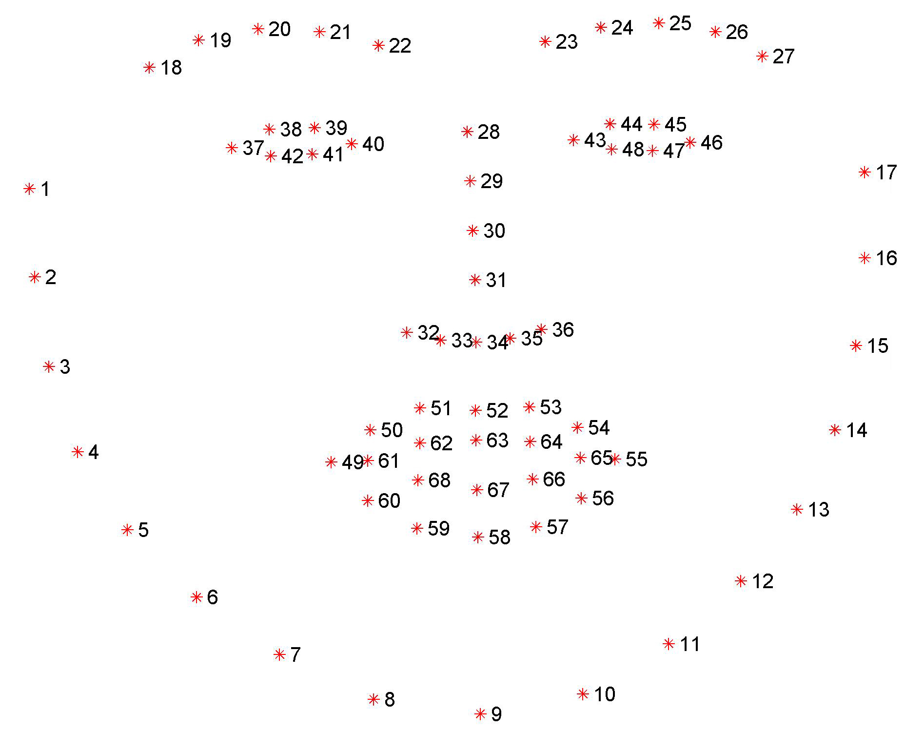

# Eyes Tracking Opencv python :eye: :eye:

Estimate the position of eyes in the frame using computer Vision Techniques.

## Control LED's color with Eyes Demo Video 

https://user-images.githubusercontent.com/66181793/122632983-77c39680-d0ef-11eb-8b60-ff82642cb67e.mp4

## Iris Tracking Medipipe Opencv python   [Video Tutorial 📹](https://youtu.be/DNKAvDeqH_Y)
https://user-images.githubusercontent.com/66181793/150673670-7b12506f-67d6-4540-96f7-ea6233c01bd6.mp4

## Eyes Tracking with Mediapipe
1. Mediapipe is way faster, has more landmarks, it can reach up to 30 fps as well. while dilb reaches about 10fps.

2. Mediapipe is easy to install, just with the pip command 

3. mediapipe does not require extra things, Visual Studio, CMake, etc on Windows machine, 

Here you can find [Project Repository](https://github.com/Asadullah-Dal17/Eyes-Position-Estimator-Mediapipe)
## Youtube Tutorials 

[**Eyes Tracking Tutorial**](https://youtu.be/obKG1SXp76Y)

[**Control Things with Eyes Tutorial**](https://youtu.be/3YDlCRS1pes)

## TODO

- [x] Eyes landmark Detection :eyes:
- [x] Blink Detector and Counter
- [x] Extracting Eyes using Masking Techniques
- [x] Threshold Eyes
- [x] Dividing Eye into Three Parts **Right Center Left**
- [x] Counting Black in Each part and Estimating The Position of Eye
- [x] Controlling RGB LED's Color With Eyes

## Installation

Steps are involved to run the code.

### Requirements are :

1. install Dlib

   #### For Windows

   - In order to install Dilb on windows machines you need the following: :smirk:

     - Visual Studio
     - Visual Studio Build Tools
     - Cmake

       for More Detail check out this Blog post. [here](https://medium.com/analytics-vidhya/how-to-install-dlib-library-for-python-in-windows-10-57348ba1117f)

   `pip install cmake `

   `pip install dlib`

   #### Linux or Mac OS

   - Just you need Cmake that all here on Linux and Mac OS
   - install Dilb using Pip command

     `pip3 install cmake`

     `pip3 install dlib`

     for more details [see](https://www.pyimagesearch.com/2018/01/22/install-dlib-easy-complete-guide/)

2. Install opencv-python
   `pip install opencv-python`
   For Linux or Mac OS replace`pip` with `pip3` and you are good to go... :wink:

3. Download landmarks [Predictor](https://github.com/davisking/dlib-models/blob/master/shape_predictor_68_face_landmarks.dat.bz2)
   - Extract that file and put it into the **Predictor** folder or directory.

---

## Face Landmarks

image shows the face landmarks available in, the dilb face landmark detector pre-trained network.

---

If you found this Helpful, please star :star: it.

You can Watch my Video Tutorial on Computer Vision Topics, just check out my YouTube Channel 

## 📫 Let's Connect

### 💼 Freelance Platforms

## 💬 Questions or Need Help?

If you have any questions or need help with the project, feel free to DM me on [Instagram](https://www.instagram.com/aiphile17)!

